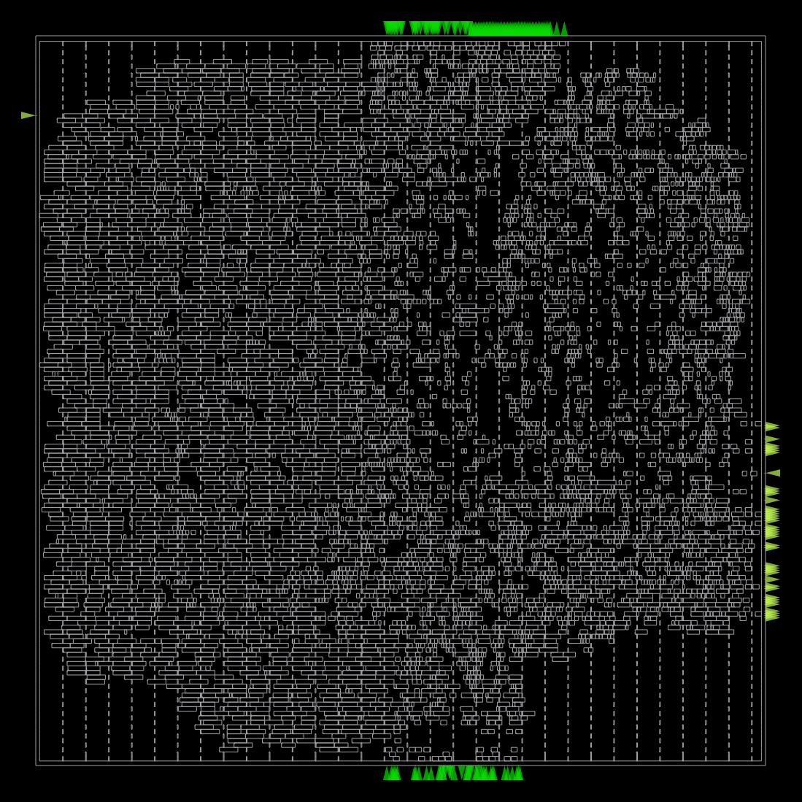
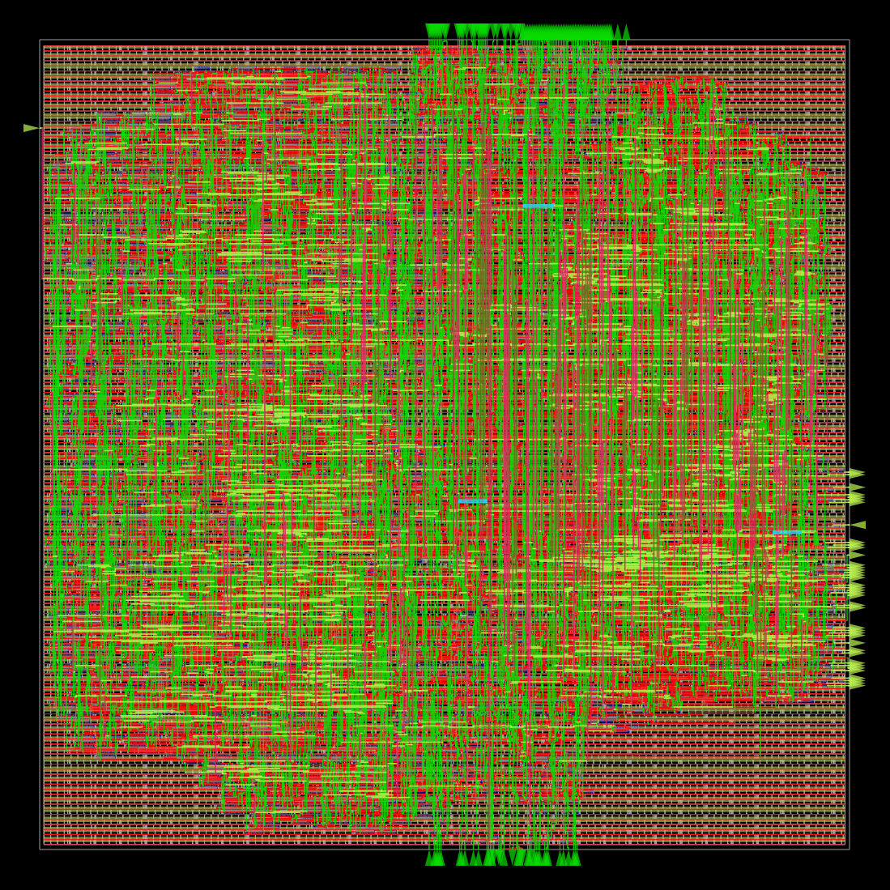
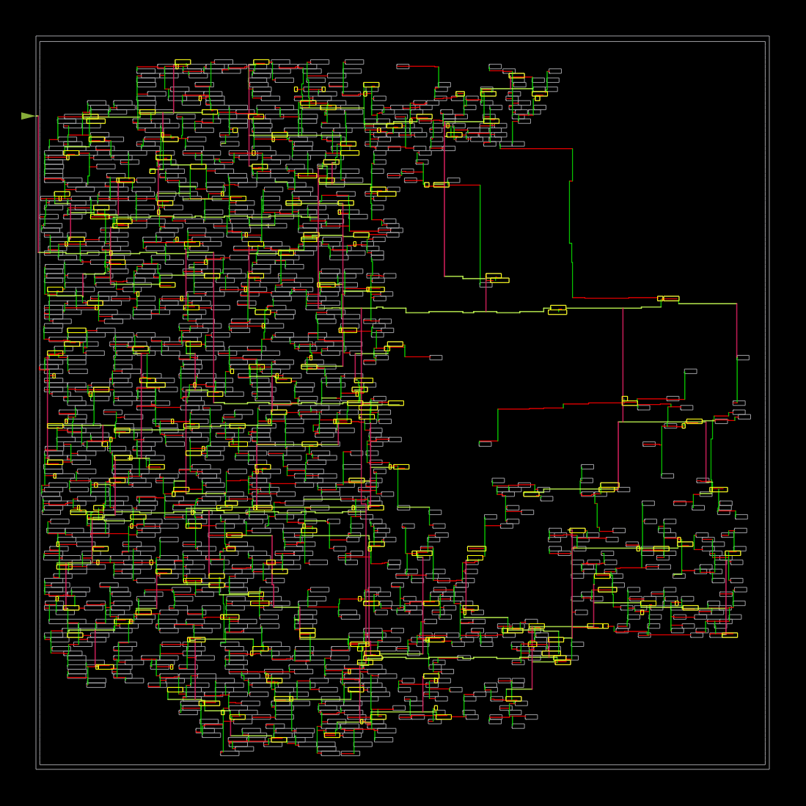
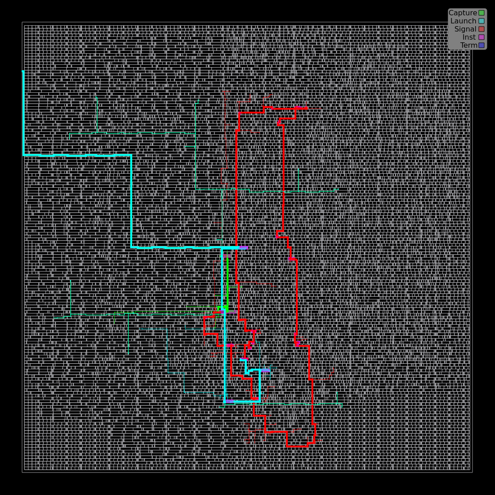

# RISC-V Processor: RTL to GDSII

A 5-stage pipelined RV32I processor core taken from Verilog RTL to a GDSII
layout on the SkyWater 130 nm process, using a fully open-source flow.

| Placement | Routing |
|---|---|
|  |  |

| Clock tree | Critical path |
|---|---|
|  |  |

## Design
- RV32I base integer instruction set, 5 stages: IF, ID, EX, MEM, WB
- Data forwarding from EX/MEM and MEM/WB, load-use stall, branch flush
- Verified with directed tests and 1,000 random programs against a Python reference model

## Results (SKY130 HD, typical corner)
| Metric | Value |
|---|---|
| Clock target | 100 MHz (10 ns) |
| Worst setup slack | +1.97 ns |
| Worst hold slack | +0.19 ns |
| Maximum frequency | 124.6 MHz |
| Die size | 438.5 x 438.5 um (0.19 mm2) |
| Cell area / utilisation | 85,193 um2 / 45 % |
| Routing violations | 0 |
| DRC violations (KLayout) | 0 |

## Tools
Icarus Verilog, Verilator, Yosys, OpenROAD (OpenROAD-flow-scripts), OpenSTA, KLayout

## How to run
    make lint        # Verilator lint
    make sim-all     # directed tests
    make random      # random programs against the reference model
    make pd          # full RTL-to-GDSII flow (needs ORFS_DIR)
    make sta         # post-route timing analysis
    make pd-drc      # KLayout design rule check

Reports of each run are kept in reports/pd/.
